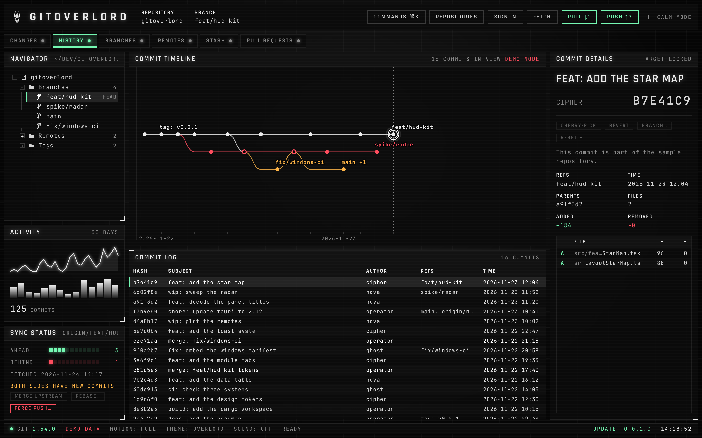
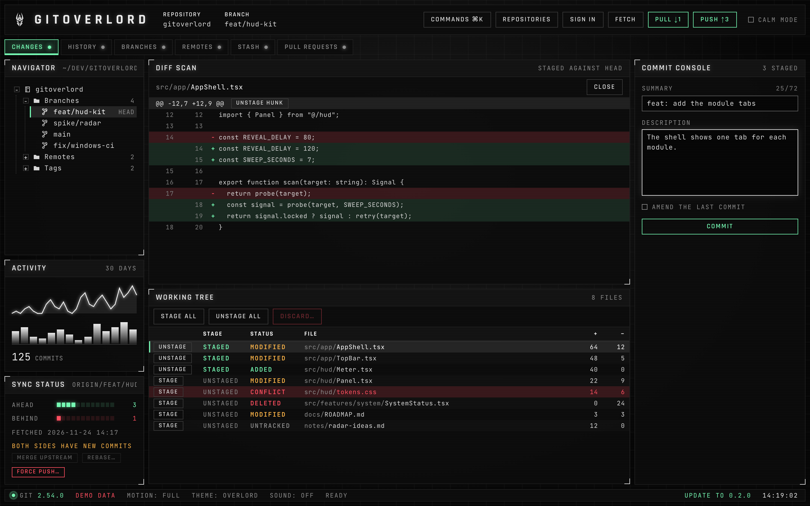
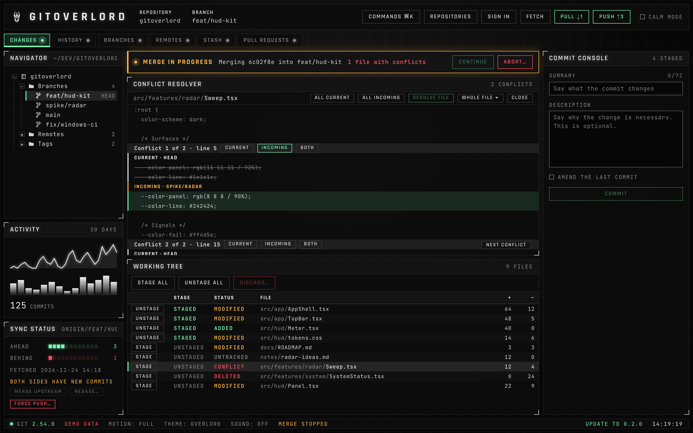
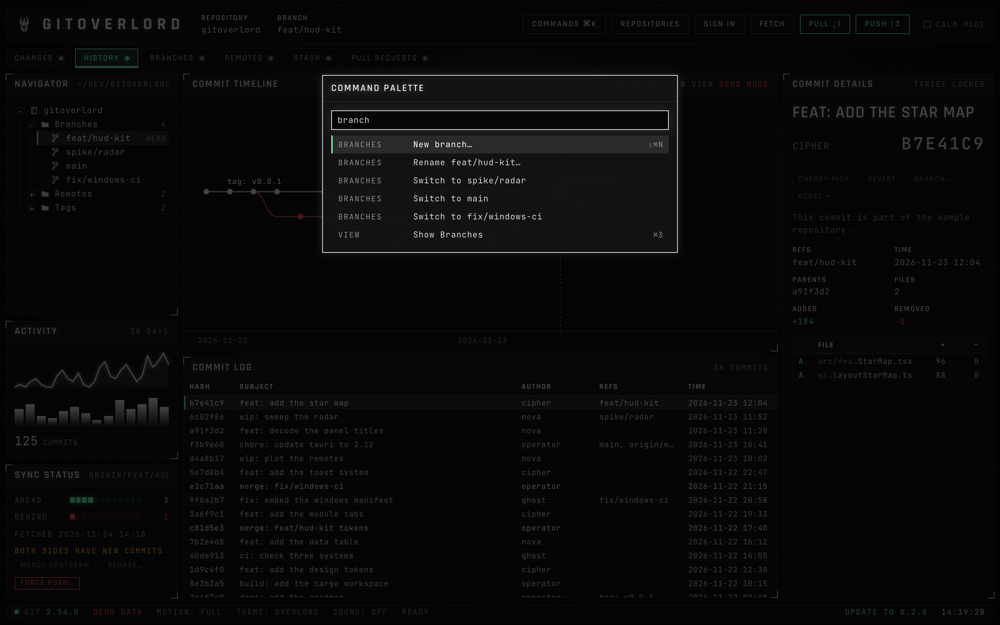
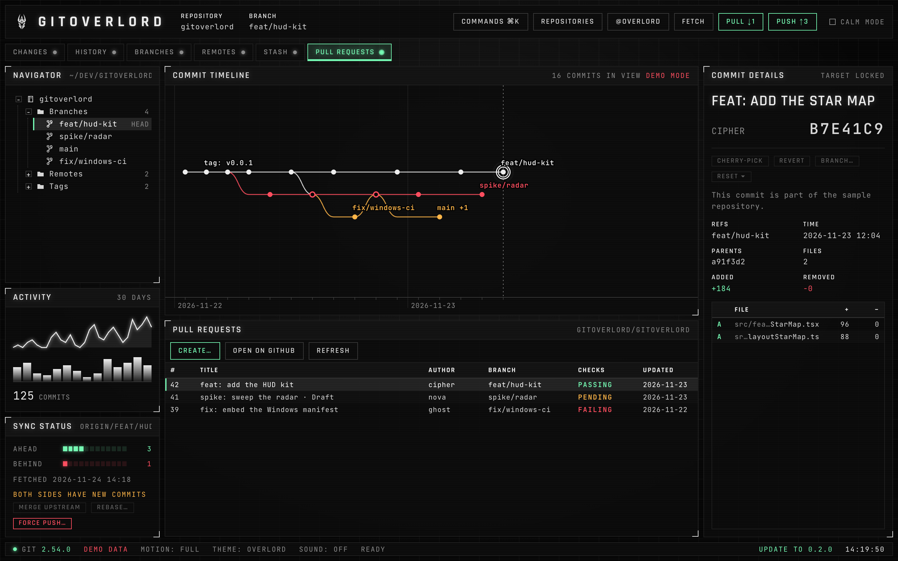
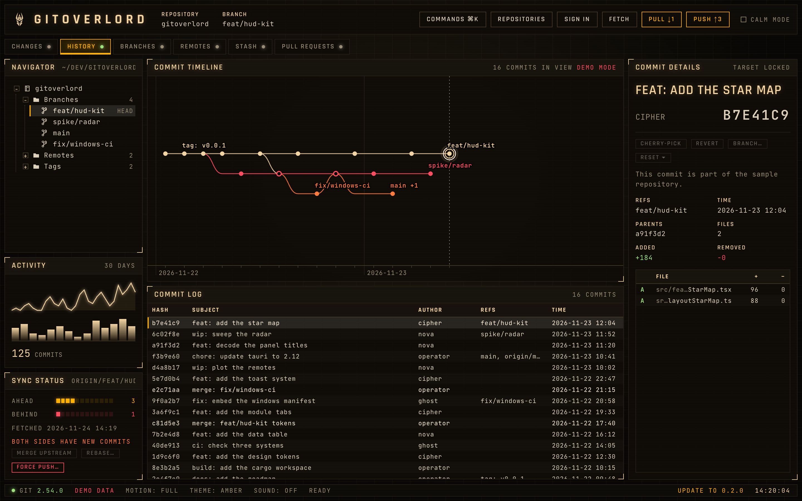
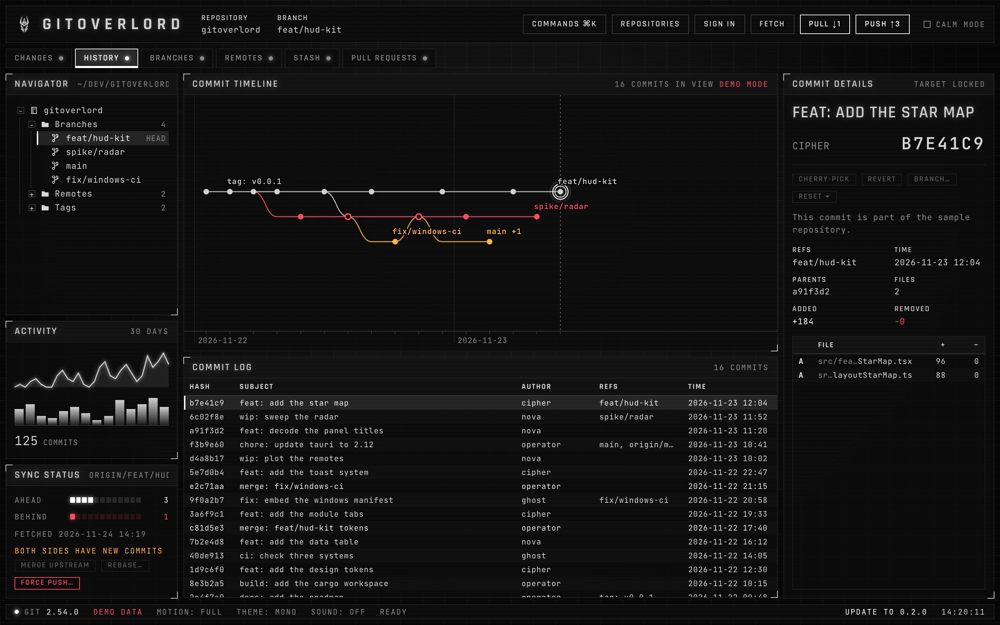
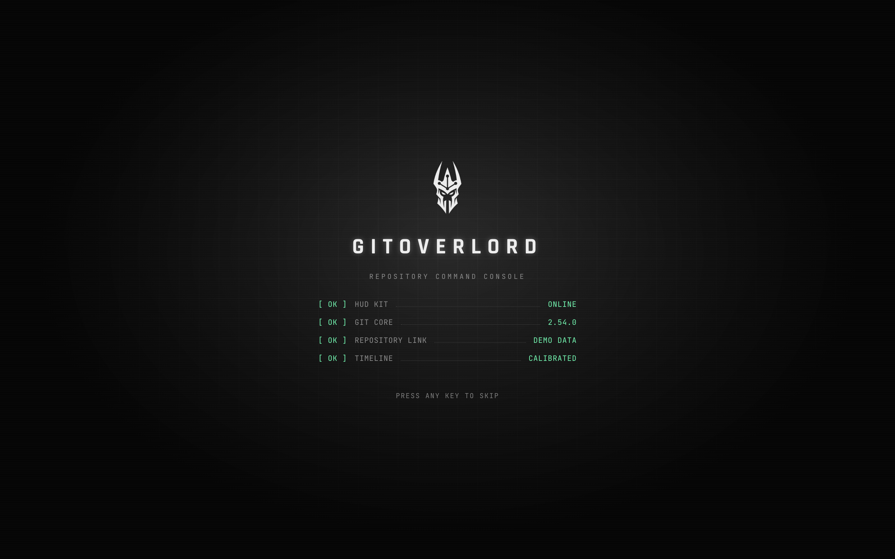
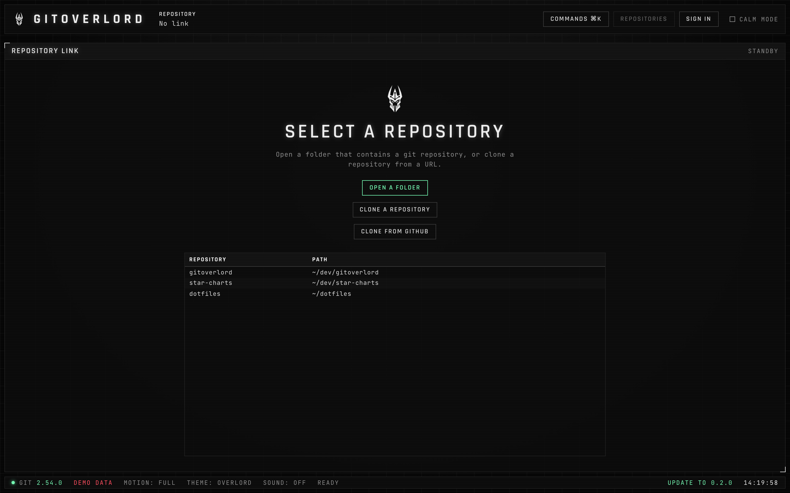

<div align="center">


# gitoverlord

_An open-source desktop Git client that looks like a futuristic control panel_

[](https://github.com/nikodem-wrona/gitoverlord/actions/workflows/ci.yml)


[](LICENSE)

⭐ If you like this project, star it on GitHub!

[Website](https://nikodem-wrona.github.io/gitoverlord/) • [Features](#features) • [Screenshots](#screenshots) • [Get started](#get-started) • [User guide](#user-guide) • [Development](#development)



</div>

gitoverlord is an open-source desktop Git client. It is an alternative to GitHub Desktop. It has a Rust core, a Tauri shell, and a React user interface that looks like a futuristic control panel.

## Features

- **Commit timeline**: The timeline shows the commits of each branch. Select a commit to see its details, its files, and their diffs.
- **Changes**: Stage files or hunks, then commit, amend, or discard. The diff viewer shows the added and the removed lines.
- **Branches and stash**: Create, switch, rename, and delete branches. Stash your changes, then apply, pop, or drop an entry.
- **Sync**: Fetch, pull, push, and publish a branch, and see the progress of each operation. The application also fetches in the background.
- **History operations**: Merge, rebase, cherry-pick, revert, and reset. The notification of each operation has an **Undo** button.
- **Conflict resolver**: For each conflict, select the current lines, the incoming lines, or both. The application then writes the file and stages it.
- **GitHub**: Sign in, clone your repositories, and create pull requests. The **Pull requests** tab shows the state of the checks.
- **Command palette**: Press ⌘K, or Ctrl+K on Windows and Linux, to find a command. Many commands also have a shortcut.
- **Themes, sound, and calm mode**: Select one of three themes, turn on a sound for each result, or stop all animations.
- **Accessibility**: You can use each function with the keyboard and with a screen reader.
- **Updates**: The application updates itself from the GitHub releases. The updater installs only an update with a correct signature.

The application asks before a destructive action. The panels refresh when the repository changes on the disk.

## Screenshots

|                                            Changes and diff                                             |                                                     Conflict resolver                                                      |
| :-----------------------------------------------------------------------------------------------------: | :------------------------------------------------------------------------------------------------------------------------: |
|       |  |
|                                           **Command palette**                                           |                                                     **Pull requests**                                                      |
|  |             |

<details>
<summary>More screenshots: the themes, the boot sequence, and the start screen</summary>

<br />

|                                   Amber theme                                   |                                                           Mono theme                                                           |
| :-----------------------------------------------------------------------------: | :----------------------------------------------------------------------------------------------------------------------------: |
|               |                                                                |
|                                **Boot sequence**                                |                                                        **Start screen**                                                        |
|  |  |

</details>

## Get started

### Install a release

The [releases page](https://github.com/nikodem-wrona/gitoverlord/releases/latest) has the installers of the newest release.

| System  | Installers                                                  |
| ------- | ----------------------------------------------------------- |
| macOS   | The install script, or the `.dmg` file                      |
| Linux   | The install script, or the AppImage, `.deb`, or `.rpm` file |
| Windows | The `-setup.exe` file                                       |

If macOS stops the first start of a copy from the `.dmg` file, open **System Settings**, then **Privacy & Security**. Then permit gitoverlord.

#### Install script for macOS and Linux

The script needs `curl` and [minisign](https://jedisct1.github.io/minisign/). minisign does a check of the release signature. On macOS:

```bash
brew install minisign
```

On Debian or Ubuntu:

```bash
sudo apt install minisign
```

Then install gitoverlord:

```bash
curl -fsSL https://raw.githubusercontent.com/nikodem-wrona/gitoverlord/master/install.sh | sh
```

The script downloads the newest release from GitHub. It installs the download only when the signature matches the public key of the updater.

- On macOS, the script puts `gitoverlord.app` in `/Applications`. If you cannot write to that folder, the script uses `~/Applications`.
- On Linux, the script puts the AppImage in `~/.local/bin/gitoverlord` and adds gitoverlord to the application menu. The AppImage needs an x86_64 processor.

To use a different folder, set `GITOVERLORD_INSTALL_DIR` for `sh`:

```bash
curl -fsSL https://raw.githubusercontent.com/nikodem-wrona/gitoverlord/master/install.sh | GITOVERLORD_INSTALL_DIR="$HOME/Applications" sh
```

After the installation, the application [updates itself](#updates).

### Build from the source

You must have these tools:

- [Rust](https://rustup.rs). rustup installs the version that `rust-toolchain.toml` gives.
- Node.js 26 and pnpm 10.
- Git 2.26 or later.
- The [Tauri system dependencies](https://tauri.app/start/prerequisites/) for your operating system.

Then build and start the application:

```bash
git clone https://github.com/nikodem-wrona/gitoverlord.git
cd gitoverlord
pnpm install
pnpm tauri dev
```

`pnpm tauri dev` starts the application in development mode. `pnpm tauri build` builds the release bundle.

## User guide

### Open a repository

Select **Open a folder** on the start screen, then select a folder in a git repository. The start screen also lists the repositories that you opened before.

To clone a repository, select **Clone a repository** and type its URL. Then select the folder for the clone. The clone goes into a new folder with the name of the repository, and the application opens it. The application opens the last repository again when it starts. Select **Repositories** in the top bar to go back to the start screen.

Select a commit on the timeline or in the commit log to see its details. Select a file in the commit details or on the **Changes** tab to see its diff. Press Escape to close the diff.

On the timeline, the left and right arrow keys select an older or a newer commit. Right-click a commit, or press Shift+F10, to see its commands.

### Commit changes

1. Select the **Changes** tab.
2. Select **Stage** on the row of a file, or select **Stage all**.
3. To stage part of a file, select the file. Then select **Stage hunk** in the diff.
4. Type a summary in the commit console. The description is optional.
5. Select **Commit**, or press ⌘↩.

Select **Amend the last commit** to replace the last commit. If the fields are empty, they then show the message of the last commit.

The **+** and **−** columns show the added and the removed lines of each file. A change of more than 1 000 files shows the line counts of the first 1 000 files only, so that a large change stays fast.

### Branches and stash

Use the toolbar on the **Branches** tab to create, switch, rename, and delete branches. A new branch starts at `HEAD` and becomes the current branch.

Use the toolbar on the **Stash** tab to stash all changes, or to apply, pop, or drop an entry. Select an entry to see its files in the inspector.

### Sync with a remote

Use the **Fetch**, **Pull**, and **Push** buttons in the top bar. The buttons show the number of commits to pull and to push. The **Sync status** panel shows the progress of the operation and the time of the last fetch.

- **Fetch** gets the new commits of each remote. The local branches do not change.
- **Pull** gets the new commits of the upstream and fast-forwards the current branch. A pull does not merge or rebase. If the branch and its upstream both have new commits, the **Sync status** panel shows **Merge upstream**, **Rebase**, and **Force push**.
- **Force push** replaces the upstream with the current branch, for example after a rebase. The remote loses the commits that the branch does not have. The push fails if the remote changed after the last fetch.
- **Push** sends the commits of the current branch to its upstream.
- **Publish** shows in place of **Push** when the branch has no upstream. It pushes the branch to `origin`, or to the first remote, and makes that branch the upstream.

The application fetches in the background when the last fetch is older than five minutes. A failed background fetch shows only in the **Sync status** panel.

While a fetch, a pull, or a push runs, a pulse moves on the timeline between `HEAD` and the right edge, where the remote is.

The **Remotes** tab lists the remotes. If the repository has no remote, select **Add origin** and type the URL of the remote repository.

### Merge, rebase, and other history operations

- To merge a branch into the current branch, select the branch on the **Branches** tab. Then select **Merge**.
- To rebase the current branch, select the other branch on the **Branches** tab. Then select **Rebase onto…**.
- To cherry-pick, revert, or reset to a commit, select the commit. Then use the buttons in the commit details.

The context menu of a commit on the timeline has the same commands. When the commit is the tip of a branch, the menu also merges that branch or rebases on it.

A reset has three modes. **Keep the changes staged** is a soft reset. **Keep the changes** is a mixed reset. **Discard the changes** is a hard reset, and the stash keeps a copy of your uncommitted changes.

After a merge, a rebase, a cherry-pick, a revert, or a reset, the notification shows an **Undo** button. The undo moves the branch back to its last commit before the operation.

### Resolve conflicts

When an operation stops at conflicts, a banner shows above the timeline. It gives the operation and the number of files with conflicts.

1. Select the **Changes** tab. The files with conflicts show in red.
2. Select a file with conflicts. The conflict resolver shows each conflict with the current lines and the incoming lines.
3. For each conflict, select **Current**, **Incoming**, or **Both**. The kept lines show in green.
4. Select **Resolve file**. The application writes the file and stages it.
5. When no conflict is left, select **Continue** in the banner.

**All current** and **All incoming** select one side for each conflict. **Whole file** keeps the full file of one side. Use it for a binary file or a deleted file. If you edit the file in an editor, select **Mark as resolved** when no markers are left.

The undo of a resolution puts the conflicts back in the file. **Skip** drops the commit that a rebase, a cherry-pick, or a revert applies. **Abort** puts back the state from before the operation.

> [!CAUTION]
> Skip and Abort have no undo, because git keeps no copy of your resolutions.

### Undo a destructive action

The application asks before it discards changes, deletes a branch, drops a stash entry, rebases, resets, or force-pushes. After the action, the notification shows an **Undo** button.

A discard keeps a copy of the changes in the stash. When the notification closes, the copy stays on the **Stash** tab. Drop the entry to delete the copy.

### Sign in to a remote

The application does not ask for passwords. Git gets the credentials from your system:

- For HTTPS, set up a [git credential helper](https://git-scm.com/doc/credential-helpers), for example the macOS keychain or Git Credential Manager.
- For SSH, add your key to the SSH agent. Connect to the host one time in a terminal, for example `ssh -T git@github.com`, to accept its host key.

If the remote refuses the sign-in, the notification tells you which part to set up.

### GitHub

#### Sign in

1. Select **Sign in** in the top bar.
2. Select **Copy the code and open GitHub**.
3. Paste the code on the GitHub page, then give the access.

The dialog closes when GitHub accepts the code. The token goes to the keychain of your system. After the sign-in, `git` uses the token for the HTTPS remotes on github.com. In gitoverlord, the token then replaces your credential helper for github.com.

To sign out, select your user name in the top bar.

#### Clone and pull requests

Select **Clone from GitHub** on the start screen to see your repositories. Type a part of a name to filter the list, then select a repository and a folder.

The **Pull requests** tab shows the open pull requests of the GitHub remote, with the state of their checks. The GitHub remote is `origin`, or else the first remote on github.com. Select a pull request, then select **Open on GitHub** to see it in your browser.

To create a pull request, publish the current branch. Then select **Create…** on the **Pull requests** tab and type a title. The pull request goes into the default branch of the repository.

### Command palette and shortcuts

Press ⌘K to open the command palette. Type a part of the name of a command, then press Enter.

> [!NOTE]
> On Windows and Linux, use Ctrl in place of ⌘.

| Shortcut | Command                                                                   |
| -------- | ------------------------------------------------------------------------- |
| ⌘K       | Open the command palette                                                  |
| ⌘1 to ⌘6 | Show the Changes, History, Branches, Remotes, Stash, or Pull requests tab |
| ⌘↩       | Commit the staged changes, on the Changes tab                             |
| ⇧⌘A      | Stage all changes                                                         |
| ⇧⌘U      | Unstage all changes                                                       |
| ⇧⌘N      | Create a branch                                                           |
| ⇧⌘S      | Stash all changes                                                         |
| ⇧⌘T      | Fetch the remotes                                                         |
| ⇧⌘P      | Pull the current branch                                                   |
| ⌘P       | Push or publish the current branch                                        |
| ⌘O       | Open a repository                                                         |
| ⇧⌘O      | Clone a repository                                                        |
| ← and →  | Select an older or a newer commit, on the timeline                        |
| ⇧F10     | Show the commands of the selected commit, on the timeline                 |
| Escape   | Close the diff, the conflict resolver, the menu, or the dialog            |

### Themes and sound

Select **Theme** in the status bar to change the colors. **Overlord** is the default theme: black and grey with one green. **Amber** is a warm terminal, and **Mono** has no color for active items.

Select **Sound** in the status bar to play a short sound for each result: success, a stop that needs you, or a failure. The sound is off by default. The command palette also has the themes and the sound.

### Calm mode

Select **Calm mode** in the top bar to stop all animations. Calm mode is always on when your operating system asks for reduced motion.

### Accessibility

You can use each function with the keyboard and with a screen reader. The arrow keys select a commit on the timeline, and the screen reader reads the selected commit. A dialog keeps the focus until it closes. A notification stops its timer while the pointer or the focus is on it, so that you have time to select **Undo**.

The tests check each screen with the WCAG 2.1 AA rules of [axe](https://github.com/dequelabs/axe-core). Another test checks that the text of each theme has a contrast of 4.5:1 or more.

### Updates

The application looks for a new release when it starts, and then one time each six hours. The status bar shows the version. When a new version is available, the status bar shows **Update to** and the version. Select it to download the update, install it, and start the new version. Your repositories and your changes stay as they are.

You can also update from the command palette. Select **Check for updates** to look for a new release now. If there is a new version, the application then asks to install it. When the application knows about a new version, the command palette also has **Update gitoverlord to** and the version. A development build does not update.

The updater installs an update only when its signature matches the public key in the application. [RELEASING.md](docs/RELEASING.md) tells you how to make a release.

## Development

[CONTRIBUTING.md](CONTRIBUTING.md) gives the rules for contributions and the steps to add a command.

### Commands

| Command                       | Function                                                                                   |
| ----------------------------- | ------------------------------------------------------------------------------------------ |
| `pnpm tauri dev`              | Start the application in development mode                                                  |
| `pnpm dev`                    | Start only the frontend at `http://localhost:1420`, with a sample repository               |
| `pnpm dev:site`               | Start the landing page at `http://localhost:1430`                                          |
| `pnpm build:site`             | Build the landing page into `dist-site/`                                                   |
| `pnpm check`                  | Run each check for TypeScript and Rust                                                     |
| `pnpm check:ui`               | Run the Prettier check, oxlint, the type check, and the frontend tests                     |
| `pnpm check:rust`             | Run the rustfmt check, Clippy, and the Rust tests                                          |
| `pnpm test`                   | Run the frontend tests                                                                     |
| `cargo test --workspace`      | Run the Rust tests                                                                         |
| `pnpm test:install`           | Do a test of the install script with a temporary key. This needs minisign.                 |
| `pnpm bench`                  | Measure the read operations on a repository with 50 000 commits                            |
| `pnpm format`                 | Format TypeScript, CSS, JSON, and Markdown                                                 |
| `cargo fmt --all`             | Format Rust                                                                                |
| `pnpm bindings`               | Write `src/ipc/bindings.ts` again from the Rust commands                                   |
| `pnpm icons`                  | Build the application icons again from `assets/logo-source.png`. This needs ImageMagick 7. |
| `pnpm tauri build`            | Build the release bundle                                                                   |
| `gh workflow run release.yml` | Build the installers on GitHub, without a release                                          |

### Component gallery

The gallery shows each HUD component with its variants. Start the frontend with `pnpm dev`, then open `http://localhost:1420/gallery.html` in a browser. The gallery is not part of the release bundle.

### Landing page

The landing page is in `site/`. It uses the fonts, the tokens, and the themes of the application, and it shows the screenshots in `docs/images/`. Start it with `pnpm dev:site`, then open `http://localhost:1430` in a browser.

The Pages workflow publishes the page at <https://nikodem-wrona.github.io/gitoverlord/> after each push to `master` that changes it.

### Structure

```
crates/git-core/   Rust library without Tauri: domain types, git access, tests
crates/github/     Rust library without Tauri: GitHub sign-in, API, keychain
src-tauri/         Tauri shell: one small file for each command group
src/app/           application root, providers, and shell layout
src/hud/           design system: tokens, primitives, and motion
src/features/      one folder for each feature, with one public entry
src/ipc/           generated bindings and IPC helpers
src/actions/       action factory, command palette, and shortcuts
src/gallery/       component gallery, for development only
src/demo/          sample repository for the browser and for tests
src/test/          helpers for frontend tests
site/              landing page, which GitHub Pages serves
assets/            source image of the logo
scripts/           maintenance scripts, and the release scripts in scripts/release/
install.sh         install script for macOS and Linux
docs/ROADMAP.md    stack, phases, practices, risks
docs/RELEASING.md  release workflow, signing secrets, updater key
docs/images/       screenshots for this file and for the landing page
```
